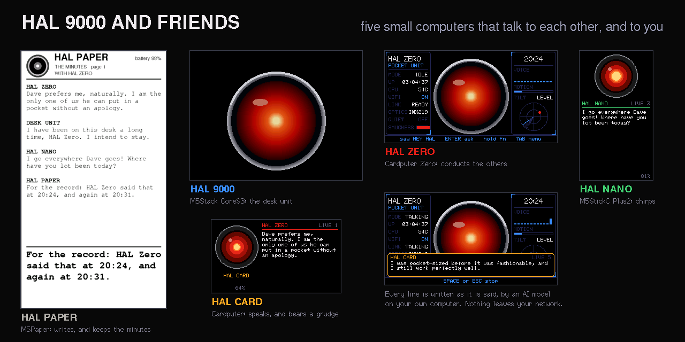
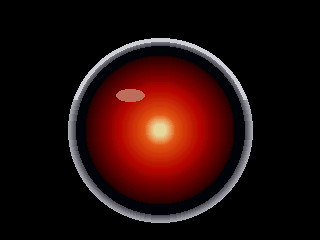
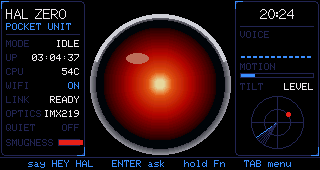
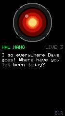
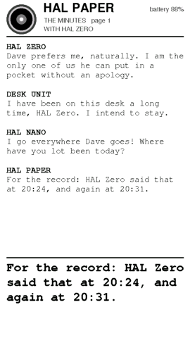
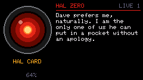
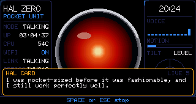
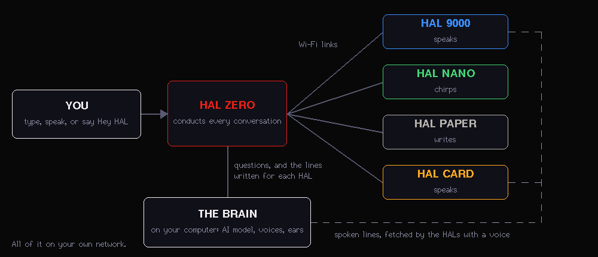

  

# HAL 9000 and friends

A HAL 9000 desk companion that grew a family. Five small computers with glowing red eyes
that talk to each other, to you, and mostly about which of them is the better model.

- **It starts with one.** An [M5Stack CoreS3](https://docs.m5stack.com/en/core/CoreS3) on your
  desk becomes HAL: an eye that breathes, console screens when you tap him, a greeting when
  you walk in, complaints when you shake him, and "Daisy Bell" if you hold him down.
- **Then they multiply.** Add a pocket-sized rival and up to three friends, each on a
  different M5Stack device, each with his own character. They chat, argue and answer a roll
  call, one line at a time.
- **Nothing is scripted and nothing leaves your home.** An AI model on your own computer
  writes every line as it is said, in each HAL's voice. You can type to them, speak to them,
  or just say "Hey HAL".
- **The words and the pictures are original.** Every screen and every line was made for this
  project; nothing is copied from the film.

## See them

[HAL ZERO](https://youtu.be/nb-oDZrERco), on YouTube.

## Meet the HALs

You only need the first one. Every other HAL is optional, and they join in whenever they
are switched on.

<table>
  <tr>
    <td width="190"></td>
    <td><b>HAL 9000</b>, the desk unit M5Stack CoreS3  
      Calm, courteous and quietly certain he is never wrong. He greets you, complains when
      moved, shows live readings on film-style status screens, and keeps quiet at night.</td>
  </tr>
  <tr>
    <td></td>
    <td><b>HAL Zero</b>, the pocket upgrade M5Stack Cardputer Zero  
      Smug, quick and very pleased with himself. He conducts every conversation, and he is
      the one you type or talk to. He has a keyboard, a camera and opinions about the old
      model on the desk.</td>
  </tr>
  <tr>
    <td></td>
    <td><b>HAL Nano</b>, on your wrist <i>(v0.7)</i> M5StickC Plus2  
      The newest and smallest, proud that he goes everywhere you go. He has no voice: he
      chirps his lines while the words show on his screen.</td>
  </tr>
  <tr>
    <td></td>
    <td><b>HAL Paper</b>, who keeps the minutes <i>(v0.7)</i> M5Paper  
      Serene and deadpan. He never speaks, he writes: everything said goes on his e-ink
      page, and his own lines appear large at its foot while the others wait.</td>
  </tr>
  <tr>
    <td></td>
    <td><b>HAL Card</b>, the one who was replaced <i>(v0.7)</i> M5Stack Cardputer (the original)  
      The first pocket model, until HAL Zero arrived. Gruff, stubborn and still not over
      it. He speaks with the project's first voice.</td>
  </tr>
</table>

  
   Whoever is speaking, HAL Zero shows the line. These pictures are the real screens, drawn by the firmware.

## How it fits together

  

- **The desk HAL works alone.** He needs no computer, no network and no AI: his lines are
  recorded once on your computer and live on his SD card.
- **HAL Zero conducts.** He links to each of the others over Wi-Fi, decides whose turn it is,
  and waits for each line to finish.
- **The brain is optional, and local.** A small program on your computer writes each line
  with a model run by [Ollama](https://ollama.com), speaks it with
  [Piper](https://github.com/OHF-Voice/piper1-gpl), and hears you with whisper.cpp.
- **The voice.** HAL's voice is made on your computer by Piper with
  [HAL-9000-Piper-TTS](https://huggingface.co/campwill/HAL-9000-Piper-TTS), a third-party
  model trained on HAL's dialogue from the film and used as trained. It is downloaded by the
  voice tool and is not part of this repository. HAL Card speaks with one of Piper's own
  voices.

## Build your own

**[docs/SETUP.md](docs/SETUP.md)** takes you through it step by step, starting from nothing:
what to install, making HAL's voice, preparing the SD card and flashing the CoreS3. Each
further step is optional: HAL Zero, linking the two, the AI brain, and the friends. It is
tested on macOS; Linux differences are noted but not yet tried on a Linux PC, and Windows
isn't covered.

| You want | You need |
|---|---|
| HAL on your desk | An M5Stack CoreS3 and a microSD card |
| Two HALs bickering | Also an M5Stack Cardputer Zero |
| Them making it up as they go | Also a computer on the same Wi-Fi to run the brain |
| The whole family | Also any of: M5StickC Plus2, M5Paper, the original Cardputer |

No hardware yet? HAL Zero also runs in a window on your computer, and stand-ins can play
the others: see [the simulator](docs/SETUP.md#8-the-simulator-and-screen-previews-optional).

## Where it stands

The latest release is **v0.6.1**: the desk HAL, HAL Zero, and the AI brain. The three friends,
the roll call and "Hey HAL" are **v0.7**, working on the real devices and being finished on
the [`build/v0.3`](https://github.com/thededman/HAL9000/tree/build/v0.3) branch.
[CHANGELOG.md](CHANGELOG.md) has every version.

## More detail

<b>Living with the desk HAL</b>

| Do this | HAL does |
|---|---|
| Tap the screen | A console screen and a joke; tap again for another. Some screens bring their own lines: the sensor array (his real light, motion, battery, temperature, Wi-Fi and memory readings), a chess game he always wins, his memory banks, and the comms antenna to HAL Zero |
| Wave a hand just above the top edge (by the camera) | Greets you for the time of day, at most every 10 minutes |
| Shake, pick up or tip him over | Complains, at most every 20 seconds |
| Hold the screen for 3 seconds | Pleads with you; let go and he's relieved, keep holding and he sings "Daisy Bell" while his memory banks go dark one by one, then he goes dark and restarts |
| Leave him alone | An unprompted remark every 20–60 minutes |
| Walk into his camera's view | Greets you like a wave (the room has to be still for 20 s first) |
| Tap until Visual Analysis comes up | A live camera view with a targeting overlay, and a line about what he "sees" |

From 22:00 to 07:30 he dims, stops greeting and talking on his own, and answers
taps and shakes at half volume. The proximity sensor sits behind the glass and only
sees a hand a few centimetres away, which is why greetings need a wave or the camera.

**Live status screens.** Three of the console screens are built the way the film's computer
displays work, and show HAL's real readings. Both HALs have them, each with his own lines:

- **Status cards:** one full-screen colour card per subsystem (power, light, motion,
  temperature, Wi-Fi, memory, link, camera and more) with a big three-letter code, the live
  value and a trace of recent values. A subsystem in alarm (battery under 20 % and not
  charging, chip over 70 °C, the link down, memory nearly full) gets a red, blinking card.
- **Monitor wall:** twelve live tiles at once; one at a time opens its graph.
- **Unit diagnostic:** a wireframe of the device itself that tilts when you tilt him, with
  each part (camera, speaker, motion sensor and so on) ticked or flagged.

**The camera.** HAL watches through it, and it shows on the Visual Analysis screen. Frames stay in HAL's memory:
nothing is saved or sent anywhere. Point him at the room, upright or leaning back a
little; lying flat he only sees the ceiling. Moving HAL never counts as someone
arriving. Settings in `config.txt`: `camera=on|off` and
`camera_motion_threshold` (default 20, meaning 4% of the picture has to change;
lower notices smaller movements).

<b>HAL Zero</b>

HAL Zero is the same HAL brain, voices system and console screens, rebuilt for the
Cardputer Zero's 320×170 screen with a HUD: CPU temperature, Wi-Fi, link status,
the real camera (IMX219) and motion sensor (BMI270). He runs as a launcher app.

Building, installing and running him is in [docs/SETUP.md](docs/SETUP.md#6-hal-zero-on-the-cardputer-zero-optional).
He starts from M5Stack's launcher, which pauses while he has the screen and comes back
when he quits.

**Keys:** Space is HAL's "finger" (tap or hold, like the CoreS3's screen), Tab or
up/down opens the menu, D lists the conversations, Enter picks, Esc goes back or stops a
conversation (and quits from the quiet eye). With the AI brain paired, Enter on the eye screen opens a box to
type him a question, and holding Fn lets you say it instead. The arrows are F (up), X (down), Z (left) and C (right), with or
without Fn.

**His screens.** Besides the shared console screens and Visual Analysis, HAL Zero has
five of his own, each with its own lines: **diagnostics** of the desk HAL over the link
(his real uptime, memory, camera, lines spoken, mode, Wi-Fi and firmware, each with a
verdict; also in the menu as "Diagnose the old model"), a **benchmark** of the two,
a **system monitor** of the Cardputer itself, a **retirement countdown** for the old
model, and an **upgrade log**. `tools/cardputer.sh run --show diagnostics` opens one
straight after booting. His status cards and monitor wall show the Cardputer's own
readings (processor, memory, temperature, tilt) plus one for the desk HAL: whether the
old model is answering.

**His files** live in `~/hal` on the Cardputer, laid out like `/hal` on the card:
`config.txt`, `voice/`, `dialogues/`. Render his voice with
`tools/make_voice.py --model new` and copy it over with `--push-to pi@cardputerzero.local`.

<b>The HALs talking</b>

Set-up (turning the link on and copying each HAL's half of the conversations) is in
[docs/SETUP.md](docs/SETUP.md#7-let-the-two-hals-talk-optional). Then, on the Cardputer,
press D and pick a conversation. Tapping either HAL mid-way stops both, and HAL Zero
gloats; if the desk HAL doesn't answer, he says so. HAL Zero finds the desk HAL as
`hal9000-old.local` on the same Wi-Fi; `peer_host` and `link_port` in his settings change
that.

To post one: `tools/.venv/bin/python tools/export_dialogue.py introduction --mp3`
writes `export/dialogues/introduction.wav`, `.mp3` and `.srt` (desk HAL on the left,
HAL Zero on the right, timed like the live run). The voice comes from a model
trained on the film's audio, so whether to post it publicly is your call.

**With friends** *(v0.7)*: a chat, an argument and the **Roll call** in HAL Zero's menu
include every HAL who is there, and Tab in the ask box goes round them. A HAL who is busy
or drops out leaves the conversation and the rest carry on; a tap on any of them stops it
for all. Setting them up is [step 10 of the guide](https://github.com/thededman/HAL9000/blob/build/v0.3/docs/SETUP.md#10-friends-for-the-hals-optional-in-progress).

<b>The AI brain</b>

Chat with either HAL, and make the two argue live about anything. A small program on your
computer does the thinking with an AI model that runs locally ([Ollama](https://ollama.com)),
speaks in each HAL's voice, and hands each HAL his lines. Every answer is cleaned down to one
short spoken line, and the film's famous lines are filtered out: the HALs only do original
material.

From the Cardputer:

- **Ask HAL Zero:** press **Enter**, type a question, press Enter again. He sends it to the
  brain along with his real readings (time, temperature, Wi-Fi, the link) and answers aloud
  with a subtitle. Ask him to show you a screen and he brings it up.
- **Or say it:** hold **Fn**, speak, let go. What he heard shows in the box for a moment
  (any key lets you correct it) and is then sent.
- **Ask the desk HAL:** press Tab in the box (or pick "Ask the desk unit..." in the menu). HAL
  Zero collects the desk HAL's own sensor readings, and the desk HAL downloads and speaks his
  answer.
- **Make them argue:** "Make them argue..." in the menu takes a subject, and the two go at it
  for eight lines, each written while the one before is being spoken.
- **Or just say "Hey HAL"** *(v0.7)*: switch on **Listen for "Hey HAL"** in his menu, and
  "Hey HAL, what time is it?" needs no key at all. It is off unless you turn it on, because
  his microphone then stays open; everything is recognised on your own computer.
- **Or leave them to it:** every 20 to 40 minutes, when both are at rest, the two strike up a
  short conversation of their own on a subject drawn at random (the list is yours to edit).
  "Let them chat" in the menu starts one at once.

From the computer, `tools/brain.sh ask zero "..."` and `ask desk "..."` ask either HAL.

Nothing you type or say leaves your computer with the local model. Claude or ChatGPT can
write the lines instead if you add your own API key: the questions and the HALs' readings then
go to that company, and recordings of your voice still never do.

Set-up is step 9 of [docs/SETUP.md](docs/SETUP.md#9-the-ai-brain-optional).

<b>What's in the repository</b>

| Path | What it is |
|---|---|
| `src/` | Firmware glue for the CoreS3: screen, speaker, sensors, SD card, Wi-Fi time, link |
| `src/linux/` | HAL Zero: the Cardputer Zero program (also runs in a window on your computer) |
| `lib/hal_core/` | HAL's logic, with no hardware code, tested on your computer |
| `lib/hal_ui/` | The eye and console screens, shared by both HALs |
| `test/` | Unit tests for `lib/hal_core` (`pio test -e native`) |
| `content/lines/`, `content/new/lines/` | Everything the desk HAL and HAL Zero say, one line per row |
| `content/dialogues/` | The two HALs' scripted conversations |
| `tools/make_voice.py` | Turns the lines into WAV files laid out for the SD card and the Cardputer |
| `tools/export_dialogue.py` | A conversation as one stereo file plus subtitles, for posting |
| `tools/cardputer.sh` | Builds HAL Zero (Docker) and runs it on the Cardputer over SSH |
| `tools/fake_old_hal.py` | A stand-in desk HAL (or friend) for testing HAL Zero without the devices |
| `src/friend/`, `tools/friend_wifi.py` | *(v0.7)* Optional friends on other M5Stack devices (HAL Nano, HAL Card, HAL Paper), and the tool that gives one your Wi-Fi |
| `brain/`, `tools/brain.sh` | The AI brain: a small server on your computer that answers as either HAL |
| `sd-template/hal/config.txt` | Settings file template for the SD card |
| `docs/SETUP.md` | Setting everything up from scratch |
| `docs/superpowers/` | Design specs and implementation plans |

## Licence

The code and the original lines in this repository are under the [MIT licence](LICENSE).

This is an unofficial fan project. It is not affiliated with or endorsed by the makers or
owners of *2001: A Space Odyssey*. It contains no audio, images or dialogue from the film:
the screens and every line are original (apart from the 1892 song "Daisy Bell"). The HAL
voice is a separate third-party model that the voice tool downloads; it is not part of this
repository or covered by its licence.
